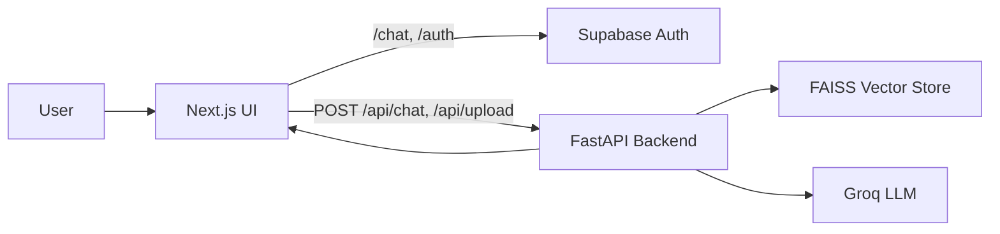

# RAG Chatbot System


> Hệ thống RAG cá nhân hóa gồm backend FastAPI + LangChain + FAISS và frontend Next.js + Supabase Auth.

## Tổng Quan

Project này xây một chatbot hỏi đáp theo tài liệu nội bộ. Người dùng đăng nhập trên frontend, gửi câu hỏi hoặc upload tài liệu, backend sẽ nạp tài liệu vào vector store, truy hồi ngữ cảnh phù hợp và dùng LLM trả lời.

## Bài Toán RAG Cá Nhân Hóa

- Mỗi người dùng có trải nghiệm riêng trên giao diện chat.
- Tài liệu được nạp và truy hồi trước khi sinh câu trả lời, giảm hiện tượng trả lời “đoán mò”.
- Hướng phát triển tiếp theo là tách dữ liệu theo `user_id` để hỗ trợ multi-tenancy trên PostgreSQL + pgvector.

## Tech Stack

| Layer | Công nghệ | Vai trò |
| --- | --- | --- |
| Frontend | Next.js 16, React 19, Tailwind CSS 4 | UI, auth flow, chat screen |
| Backend | FastAPI, LangChain, FAISS | API, RAG pipeline, retrieval |
| Auth | Supabase Auth | Email/password, Google OAuth |
| LLM | Groq | Sinh câu trả lời cuối |
| Embedding | BAAI/bge-m3 | Chuyển văn bản thành vector |

## Kiến Trúc Hệ Thống



## Luồng Dữ Liệu FE - BE - Supabase

1. User đăng nhập ở frontend qua Supabase.
2. `proxy.ts` chặn route `/chat` nếu chưa có session.
3. Frontend gửi câu hỏi hoặc file upload sang backend FastAPI.
4. Backend đọc tài liệu, chia chunk, embed và lưu vào FAISS.
5. Khi hỏi đáp, backend truy hồi context liên quan rồi gọi Groq để sinh câu trả lời.

## Cấu Trúc Repo

| Path | Nội dung |
| --- | --- |
| `README.md` | Tổng quan hệ thống và quick start |
| `src/README.md` | Tài liệu backend FastAPI + RAG pipeline |
| `rag-ui/README.md` | Tài liệu frontend Next.js + Supabase Auth |
| `src/` | Mã nguồn backend |
| `rag-ui/` | Mã nguồn frontend |

## Quick Start

### 1) Backend

```bash
python -m venv .venv
.venv\Scripts\activate
pip install -r requirements.txt
```

Tạo file `.env` ở root và thêm tối thiểu:

```env
GROQ_API_KEY=your_groq_api_key
GROQ_MODEL=llama-3.1-8b-instant
EMBEDDING_MODEL=BAAI/bge-m3
EMBEDDING_DEVICE=cpu
```

Chạy server:

```bash
uvicorn src.main:app --reload
```

### 2) Frontend

```bash
cd rag-ui
npm install
npm run dev
```

Tạo file `rag-ui/.env.local`:

```env
NEXT_PUBLIC_SUPABASE_URL=https://your-project.supabase.co
NEXT_PUBLIC_SUPABASE_ANON_KEY=your_anon_key
```

### 3) Mở ứng dụng

- Backend docs: `http://localhost:8000/docs`
- Frontend: `http://localhost:3000`

## Ghi Chú Nhanh

- Backend hiện có endpoint `/api/chat` và `/api/upload`.
- Frontend đang gọi backend qua `http://localhost:8000/api` trong `rag-ui/lib/api.ts`.
- Nếu chưa upload tài liệu, backend sẽ trả về fallback thay vì làm chain bị lỗi.

## Tài Liệu Chi Tiết

- [Backend README](src/README.md)
- [Frontend README](rag-ui/README.md)
