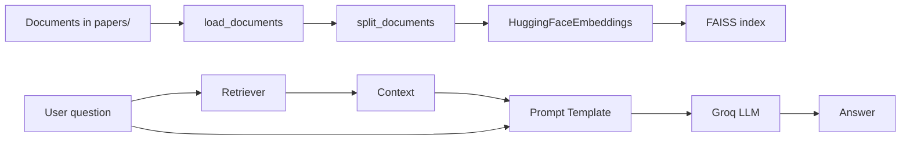

# Backend README - FastAPI + LangChain RAG


> Backend xử lý ingest tài liệu, build vector store, truy hồi ngữ cảnh và sinh câu trả lời cho chatbot.

## Tổng Quan Backend & RAG Pipeline

Backend hiện được tổ chức theo pipeline khá rõ:

| Bước | File | Mô tả |
| --- | --- | --- |
| Config | `src/config.py` | Đọc biến môi trường và cấu hình chung |
| Ingestion | `src/ingestion.py` | Load tài liệu, split chunk, embed, build/load FAISS |
| Retriever | `src/retriever.py` | Tạo retriever từ vector store |
| LLM | `src/llm_service.py` | Khởi tạo Groq LLM và prompt template |
| Chain | `src/pipeline.py` | Ghép retriever + prompt + LLM + parser |
| API | `src/api/routes/chat.py` | `/api/chat` và `/api/upload` |
| App | `src/main.py` | FastAPI app + lifespan |

## Kiến Trúc Xử Lý



## Cấu Hình Môi Trường

Backend đọc `.env` ở root project qua `pydantic-settings`.

```env
GROQ_API_KEY=your_groq_api_key
GROQ_MODEL=llama-3.1-8b-instant
EMBEDDING_MODEL=BAAI/bge-m3
EMBEDDING_DEVICE=cpu
CHUNK_SIZE=1200
CHUNK_OVERLAP=200
PAPER_DIRS=papers/
FAISS_INDEX=faiss_index/ (Demo)
TOP_K=5
SCORE_THRESHOLD=-0.1
```

### `venv` và chạy server

```bash
python -m venv .venv
.venv\Scripts\activate
pip install -r requirements.txt
uvicorn src.main:app --reload
```

## API Chính

| Method | Endpoint | Mục đích |
| --- | --- | --- |
| `POST` | `/api/chat` | Nhận câu hỏi và trả lời từ chain |
| `POST` | `/api/upload` | Upload tài liệu mới rồi rebuild index |

### `/api/chat`

- Nếu chain chưa sẵn sàng hoặc không có tài liệu, backend trả fallback message thay vì ném lỗi.
- Endpoint dùng `Depends(get_chain)` để lấy chain từ `src/dependencies.py`.

### `/api/upload`

- Chỉ nhận `.txt`, `.pdf`, `.docx`.
- File được lưu vào `papers/`.
- Sau khi upload, backend gọi `create_rag_chain(rebuild=True)` để build lại FAISS và refresh chain.

## Dòng Chạy Quan Trọng

```python
deps.rag_chain = create_rag_chain(rebuild=False)
```

- `lifespan` trong `src/main.py` khởi tạo chain lúc server start.
- `src/pipeline.py` sẽ trả `None` nếu không có tài liệu, để server vẫn lên nhưng chat có fallback an toàn.

## Nhật Ký Phát Triển & Lỗi Đã Gặp

### 1) User chưa upload document

**Triệu chứng:** gọi `/api/chat` nhưng chưa có file nào trong `papers/` thì chain không thể tạo.

**Fix:** `load_or_build()` trả `None` khi không có document, và `create_rag_chain()` cũng trả `None` tương ứng. Ở route chat, nếu `chain is None` thì trả message hướng dẫn user upload file trước.

**Bài học:** RAG backend nên fail mềm. Không có tài liệu thì UI vẫn sống, chỉ cần trả fallback rõ ràng cho user.

### 2) Thiết kế multi-tenancy bằng PGVector

**Mục tiêu:** mỗi user chỉ truy hồi tài liệu của chính họ.

**Thiết kế đề xuất:**

| Thành phần | Ý tưởng |
| --- | --- |
| `user_id` | Gắn vào metadata của từng chunk |
| Vector store | Chuyển từ FAISS local sang PostgreSQL + pgvector |
| Query filter | Lọc theo `user_id` khi retrieve |
| Upload flow | Index tài liệu theo chủ sở hữu thay vì index chung |

**Bài học:** với bài toán nhiều người dùng, vector store local phù hợp demo nhưng không đủ cho production vì thiếu isolation và quản trị quyền truy cập.

### 3) Triển khai Multi-tenancy & Quản lý vòng đời dữ liệu

**Mục tiêu:** Đảm bảo mỗi user chỉ truy vấn được dữ liệu của chính họ và có thể cập nhật/xóa file riêng mà không ảnh hưởng đến người khác, đồng thời khắc phục lỗi `Collection not found`.

#### Nguyên tắc *Gắn nhãn & Lọc* (Tag & Filter)

Thay vì tạo nhiều collection (gây khó quản lý), ta sử dụng một collection chung (`documents`) và phân tách dữ liệu bằng metadata.

* **Khi Upload (Ingestion):** Bắt buộc gắn `user_id` và `file_name` vào metadata của từng chunk.
* **Khi Query (Retrieval):** Bắt buộc truyền filter chứa `user_id` vào hàm tìm kiếm. PostgreSQL sẽ tự động loại bỏ các kết quả không thuộc về user đó ở tầng database.

#### Quy trình xử lý khi User Upload/Update file

Để tránh lỗi `Collection not found` (do xóa collection rồi vẫn cố ghi vào) và đảm bảo dữ liệu không bị trùng lặp khi user upload lại file cũ, ta áp dụng quy trình **Xóa theo điều kiện → Thêm mới**:

1. **Nhận request:** User upload file `A.pdf`. Hệ thống xác định `user_id` và `file_name`.
2. **Dọn dẹp (Clean up):** Thực hiện xóa các vector cũ trong collection `documents` thỏa mãn điều kiện:

   * `user_id = X`
   * `file_name = 'A.pdf'`
3. **Lưu ý quan trọng:** Không dùng `vectorstore.delete_collection()` vì nó xóa cả bảng chứa dữ liệu của mọi người. Chỉ xóa các dòng (`rows`) thỏa mãn điều kiện.
4. **Index mới:** Chia nhỏ file mới, gắn metadata (`user_id`, `file_name`) và thêm vào collection chung.

#### Cập nhật Code mẫu (Implementation Details)

Hàm hỗ trợ xóa dữ liệu cũ của một file (**Raw SQL**):

Do `langchain_postgres` chưa hỗ trợ sẵn hàm `delete_by_metadata` mạnh mẽ trong mọi phiên bản, ta nên dùng câu lệnh **SQL** trực tiếp qua engine kết nối để đảm bảo hiệu năng và chính xác.

```python
from sqlalchemy import text

def delete_user_file_vectors(vectorstore, user_id: str, file_name: str):
    """
    Xóa các vector thuộc về user_id và file_name cụ thể.
    Không xóa toàn bộ collection, chỉ xóa dữ liệu của riêng user đó.
    """
    with vectorstore._engine.connect() as conn:
        statement = text("""
            DELETE FROM langchain_pg_embedding
            WHERE collection_id = (
                SELECT uuid
                FROM langchain_pg_collection
                WHERE name = :coll_name
            )
            AND cmetadata->>'user_id' = :uid
            AND cmetadata->>'file_name' = :fname
        """)

        conn.execute(
            statement,
            {
                "coll_name": "documents",
                "uid": user_id,
                "fname": file_name,
            }
        )
        conn.commit()
```

#### Luồng API Upload hoàn chỉnh

```python
@app.post("/upload")
async def upload_file(
    file: UploadFile,
    current_user: User = Depends(get_current_user)
):
    # 1. Khởi tạo vectorstore
    # Kết nối đến collection CHUNG "documents"
    vectorstore = connect_to_pgvector()

    # 2. Xử lý file & chia chunks
    docs = load_documents(file)
    chunks = split_documents(docs)

    # 3. Gán metadata bắt buộc để phân quyền
    for chunk in chunks:
        chunk.metadata["user_id"] = current_user.id
        chunk.metadata["file_name"] = file.filename

    # 4. Xóa dữ liệu cũ của file này
    # Nếu user upload lại file trùng tên,
    # bước này ngăn việc trùng lặp nội dung
    delete_user_file_vectors(
        vectorstore,
        current_user.id,
        file.filename
    )

    # 5. Thêm dữ liệu mới vào collection chung
    # Lưu ý: Không gọi delete_collection() ở đây nữa!
    vectorstore.add_documents(chunks)

    return {
        "status": "indexed",
        "file": file.filename
    }
```

#### Luồng API Chat (Query có lọc)

```python
@app.post("/chat")
async def chat(
    query: str,
    current_user: User = Depends(get_current_user)
):
    vectorstore = connect_to_pgvector()

    # BẮT BUỘC: Lọc theo user_id để đảm bảo an toàn dữ liệu
    # Nếu không có filter này, user có thể truy vấn dữ liệu của người khác
    filter_criteria = {
        "user_id": current_user.id
    }

    docs = vectorstore.similarity_search(
        query=query,
        k=4,
        filter=filter_criteria
    )

    # ... gửi docs vào LLM và trả lời
```

#### Tổng kết lợi ích

| Vấn đề cũ                                       | Giải pháp mới                                         |
| ----------------------------------------------- | ----------------------------------------------------- |
| `delete_collection()` xóa hết dữ liệu mọi người | `DELETE WHERE` chỉ xóa dữ liệu của 1 user/file cụ thể |
| Lỗi `ValueError: Collection not found`          | Giữ nguyên bảng, chỉ thao tác trên các dòng dữ liệu   |
| Rò rỉ dữ liệu giữa các user                     | Chặn bằng `filter` ở tầng truy vấn                    |
| Khó quản lý khi có hàng nghìn user              | Chỉ cần 1 collection duy nhất, dễ mở rộng             |

**Bài học:** Multi-tenancy nên được thiết kế bằng cách dùng một collection chung kết hợp với metadata (`user_id`, `file_name`) và filter ở tầng retrieval. Khi cập nhật file, chỉ xóa các vector thuộc đúng user và file đó thay vì xóa toàn bộ collection.


## Troubleshooting

| Vấn đề | Nguyên nhân | Cách xử lý |
| --- | --- | --- |
| Server không start | Thiếu `GROQ_API_KEY` | Kiểm tra `.env` ở root |
| Không tìm thấy tài liệu | Thư mục `papers/` trống | Upload file hoặc thêm tài liệu mới |
| Chat trả lời yếu | Context không đủ liên quan | Tuning `TOP_K` và `SCORE_THRESHOLD` |
| Index cũ không cập nhật | Chưa rebuild | Dùng upload API hoặc chạy lại với `rebuild=True` |

## Quick Commands

```bash
# Run backend
uvicorn src.main:app --reload

# Rebuild index via CLI entrypoint nếu dự án có hỗ trợ
python chatbot.py --rebuild-index
```
