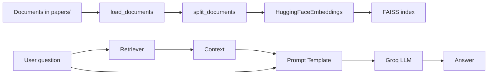

# Backend README - FastAPI + LangChain RAG


> Backend xử lý ingest tài liệu, build vector store, truy hồi ngữ cảnh và sinh câu trả lời cho chatbot.

## Tổng Quan Backend & RAG Pipeline

Backend hiện được tổ chức theo pipeline khá rõ:

| Bước | File | Mô tả |
| --- | --- | --- |
| Config | `src/config.py` | Đọc biến môi trường và cấu hình chung |
| Ingestion | `src/ingestion.py` | Load tài liệu, split chunk, embed, build/load FAISS |
| Retriever | `src/retriever.py` | Tạo retriever từ vector store |
| LLM | `src/llm_service.py` | Khởi tạo Groq LLM và prompt template |
| Chain | `src/pipeline.py` | Ghép retriever + prompt + LLM + parser |
| API | `src/api/routes/chat.py` | `/api/chat` và `/api/upload` |
| App | `src/main.py` | FastAPI app + lifespan |

## Kiến Trúc Xử Lý



## Cấu Hình Môi Trường

Backend đọc `.env` ở root project qua `pydantic-settings`.

```env
GROQ_API_KEY=your_groq_api_key
GROQ_MODEL=llama-3.1-8b-instant
EMBEDDING_MODEL=BAAI/bge-m3
EMBEDDING_DEVICE=cpu
CHUNK_SIZE=1200
CHUNK_OVERLAP=200
PAPER_DIRS=papers/
FAISS_INDEX=faiss_index/
TOP_K=5
SCORE_THRESHOLD=-0.1
```

### `venv` và chạy server

```bash
python -m venv .venv
.venv\Scripts\activate
pip install -r requirements.txt
uvicorn src.main:app --reload
```

## API Chính

| Method | Endpoint | Mục đích |
| --- | --- | --- |
| `POST` | `/api/chat` | Nhận câu hỏi và trả lời từ chain |
| `POST` | `/api/upload` | Upload tài liệu mới rồi rebuild index |

### `/api/chat`

- Nếu chain chưa sẵn sàng hoặc không có tài liệu, backend trả fallback message thay vì ném lỗi.
- Endpoint dùng `Depends(get_chain)` để lấy chain từ `src/dependencies.py`.

### `/api/upload`

- Chỉ nhận `.txt`, `.pdf`, `.docx`.
- File được lưu vào `papers/`.
- Sau khi upload, backend gọi `create_rag_chain(rebuild=True)` để build lại FAISS và refresh chain.

## Dòng Chạy Quan Trọng

```python
deps.rag_chain = create_rag_chain(rebuild=False)
```

- `lifespan` trong `src/main.py` khởi tạo chain lúc server start.
- `src/pipeline.py` sẽ trả `None` nếu không có tài liệu, để server vẫn lên nhưng chat có fallback an toàn.

## Nhật Ký Phát Triển & Lỗi Đã Gặp

### 1) User chưa upload document

**Triệu chứng:** gọi `/api/chat` nhưng chưa có file nào trong `papers/` thì chain không thể tạo.

**Fix:** `load_or_build()` trả `None` khi không có document, và `create_rag_chain()` cũng trả `None` tương ứng. Ở route chat, nếu `chain is None` thì trả message hướng dẫn user upload file trước.

**Bài học:** RAG backend nên fail mềm. Không có tài liệu thì UI vẫn sống, chỉ cần trả fallback rõ ràng cho user.

### 2) Thiết kế multi-tenancy bằng PGVector

**Mục tiêu:** mỗi user chỉ truy hồi tài liệu của chính họ.

**Thiết kế đề xuất:**

| Thành phần | Ý tưởng |
| --- | --- |
| `user_id` | Gắn vào metadata của từng chunk |
| Vector store | Chuyển từ FAISS local sang PostgreSQL + pgvector |
| Query filter | Lọc theo `user_id` khi retrieve |
| Upload flow | Index tài liệu theo chủ sở hữu thay vì index chung |

**Bài học:** với bài toán nhiều người dùng, vector store local phù hợp demo nhưng không đủ cho production vì thiếu isolation và quản trị quyền truy cập.

## Troubleshooting

| Vấn đề | Nguyên nhân | Cách xử lý |
| --- | --- | --- |
| Server không start | Thiếu `GROQ_API_KEY` | Kiểm tra `.env` ở root |
| Không tìm thấy tài liệu | Thư mục `papers/` trống | Upload file hoặc thêm tài liệu mới |
| Chat trả lời yếu | Context không đủ liên quan | Tuning `TOP_K` và `SCORE_THRESHOLD` |
| Index cũ không cập nhật | Chưa rebuild | Dùng upload API hoặc chạy lại với `rebuild=True` |

## Quick Commands

```bash
# Run backend
uvicorn src.main:app --reload

# Rebuild index via CLI entrypoint nếu dự án có hỗ trợ
python chatbot.py --rebuild-index
```
